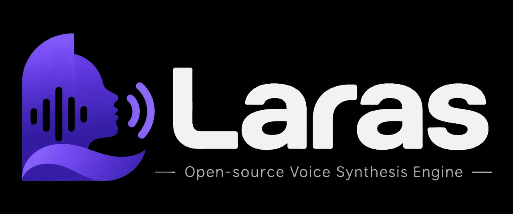

<p align="center">
  <picture>
    <source media="(prefers-color-scheme: dark)" srcset="assets/laras-banner-dark.png">
    <source media="(prefers-color-scheme: light)" srcset="assets/laras-banner-light.png">
    
  </picture>
</p>

# Laras

**Open-source voice synthesis engine.** Give your words a voice.

CPU-first · Self-hosted · Voice cloning · Indonesian-first

[](https://github.com/Urdemonlord/laras-tts/actions/workflows/ci.yml)
[](#lisensi)
[](https://www.rust-lang.org)

Laras mengubah teks Bahasa Indonesia menjadi suara yang menyerupai suara
referensi 10–15 detik — di CPU, tanpa GPU, di mesin yang kamu miliki sendiri.

Bukan model baru. Ini lapisan produksi di atas
[Pocket TTS](https://github.com/kyutai-labs/pocket-tts) + bobot
[pocket-tts-indonesian](https://huggingface.co/anak10thn/pocket-tts-indonesian)
yang menambal empat hal yang membuat model mentah belum layak dipakai:

| Masalah model mentah | Yang dilakukan Laras |
|---|---|
| Angka dibaca kacau (`15` → "satu lima", WER 0,71) | normalizer angka Indonesia di Rust (`Rp 12.500` → "dua belas ribu lima ratus rupiah") |
| Berhenti di ~16 detik lalu mengarang | chunking per kalimat + jeda 0,12 s |
| Referensi >15 detik merusak hasil (WER 0,75–1,0) | potong referensi otomatis, ambil dari sampel bersuara pertama |
| Output tidak stabil antar-generate | N take, pilih yang WER-nya terendah (Whisper di dalam proses) |

Hasil terukur pada **394 kalimat** (Tatoeba, temp 0,10, satu take):
**WER 0,19–0,22**, 42–48% kalimat tanpa salah kata, kemiripan suara
**0,80–0,89** (Resemblyzer), tanpa GPU. Angka 0,00–0,08 yang beredar di
versi awal README berasal dari 12 kalimat pilihan — jangan dipakai.

Pemilihan take berbasis ASR memang menolong, walau tidak gratis. Pada 60
kalimat berpasangan (3 take, temp 0,10):

| | WER | kalimat bersih |
|---|---|---|
| take pertama (tanpa seleksi) | 0,143 | 53% |
| **dipilih ASR** | **0,108** | **63%** |
| oracle (batas atas, 3 take) | 0,098 | – |

Selisih berpasangan **−0,035, CI95 [−0,070, −0,001]**; menang 18%, kalah 3%,
seri 78%. Artinya selektor mengambil hampir seluruh keuntungan yang tersedia
(0,108 vs batas 0,098).

Ketiga take ditranskrip dalam **satu lintasan encoder** (digabung dengan jeda
1,5 s lalu dipetakan balik per waktu), dan itu memilih take yang persis sama
dengan cara terpisah — hanya lebih cepat: ±14–19 s per permintaan di 4 vCPU
versus ±22 s. Mendengar 2 detik pertama saja juga cukup akurat (0,105 vs
0,108) tapi tidak menghemat waktu, karena biayanya di jendela encoder.
Ongkos ASR tetap nyata: pakai untuk batch, bukan pratonton.

## Posisi proyek

**Produk: Bahasa Indonesia dulu. Arsitektur: tidak dikunci ke satu bahasa.**

Yang membuat Laras berguna hari ini adalah Bahasa Indonesia: belum ada engine
kloning suara open source yang jalan di CPU dan mendukung bahasa ini dengan
baik. Tapi bagian yang spesifik-bahasa dipisah ke `src/lang/`, di belakang
trait `Lang` (normalisasi + perbaikan fonem). Menambah bahasa = menambah satu
berkas, bukan menulis ulang engine:

```rust
// src/lang/mod.rs
pub trait Lang: Sync + Send {
    fn code(&self) -> &'static str;
    fn normalize(&self, text: &str) -> String;
    fn phoneme_fix(&self, text: &str) -> String { text.to_string() }
}
```

Bahasa dipilih saat runtime: `LARAS_LANG=id` (default).

## Coba cepat

```bash
git clone https://github.com/Urdemonlord/laras-tts && cd laras-tts
scripts/unduh-model.sh          # bobot ONNX + contoh referensi CC0 (±160 MB)
docker compose up -d            # image dari ghcr, tidak build lokal
curl -X POST localhost:8080/tts -H 'content-type: application/json' \
  -d '{"text":"Harga saham naik 15 persen menjadi Rp 12.500 per lembar pada 2026."}' \
  -o hasil.wav -D -
# x-cache: miss · x-duration: 5.20 · x-wer: 0.050
```

Contoh lengkap: [`examples/curl.sh`](examples/curl.sh).

### Menyiapkan model

`scripts/unduh-model.sh` mengunduh 9 berkas dari
[`anak10thn/pocket-tts-indonesian`](https://huggingface.co/anak10thn/pocket-tts-indonesian)
dan **memverifikasi sha256** tiap berkas. Kalau hash-nya tidak cocok, skrip
berhenti dengan kode 1 — tidak ada unduhan setengah jadi yang diam-diam dipakai.

```bash
scripts/unduh-model.sh --cek          # hanya verifikasi yang sudah ada
scripts/unduh-model.sh --tanpa-ref    # model saja
scripts/unduh-model.sh --dir /data/models --ref-dir /data/ref
```

| Berkas | Ukuran |
|---|---|
| `flow_lm_main_int8.onnx` | 72,4 MB |
| `mimi_encoder.onnx` | 37,4 MB |
| `mimi_decoder_int8.onnx` | 21,6 MB |
| `text_conditioner.onnx` | 15,6 MB |
| `flow_lm_flow_int8.onnx` | 9,5 MB |
| `tokenizer.model`, `bos_before_voice.npy`, `bundle.json`, `VALIDATION.txt` | < 0,4 MB |

Repo Hugging Face-nya publik, jadi tidak perlu login. (Bobot asli
`kyutai/pocket-tts` **gated** — itu hanya relevan kalau kamu mau mengekspor
graf ONNX sendiri.)

### Referensi suara

`REF_WAV` menerima **WAV, MP3, m4a, ogg, flac**. Selain WAV dikonversi otomatis
ke WAV 24 kHz mono lewat `ffmpeg` (sekali saja; hasilnya dipakai ulang selama
berkasnya tidak berubah). Kalau `ffmpeg` tidak ada, galatnya menyebutkan
perintah konversi manual — bukan sekadar "hanya WAV yang didukung".

Contoh referensi dari skrip di atas berasal dari Common Voice 22.0 Indonesia,
**CC0**, 48 kHz mono ±4,7 detik. Untuk suara sendiri, rekam 10–15 detik tanpa
musik latar. Prompt 48 kHz menghasilkan kloning yang jauh lebih mirip daripada
audio 16 kHz yang dikompresi.

## Pakai image Docker

Image publik, dibangun di CI (bukan di mesin-mesinmu):

```bash
docker run --rm -p 8080:8080 \
  -v "$PWD/data:/data" \
  ghcr.io/urdemonlord/laras-tts:0.2.1
```

Image hanya berisi satu binary native (ONNX Runtime ter-link statis, tanpa
Python) plus `ffmpeg` untuk konversi referensi. Yang perlu disediakan di volume
`/data`: graf ONNX di `/data/models` dan rekaman referensi di `/data/ref/` —
lihat tabel [Konfigurasi](#konfigurasi). Tanpa model, proses berhenti dengan
`gagal memuat model ONNX`.

Base image `debian:trixie-slim` dipilih karena binary menuntut `GLIBC_2.38`;
di bookworm (glibc 2.36) binary tidak bisa di-link sama sekali.

**Dua arsitektur**: `linux/amd64` dan `linux/arm64` dalam satu manifest, jadi
Mac M-series, Graviton, dan Ampere menarik varian yang benar tanpa embel-embel
`--platform`. Keduanya dibangun di runner native masing-masing lalu manifest-nya
digabung — bukan lewat QEMU, karena emulasi build Rust sebesar ini 5–10× lebih
lambat.

## Instalasi manual

Butuh Rust ≥ 1.92 (dipaksa `ort 2.0.0-rc.15`), Python ≥ 3.10, ±2,5 GB RAM
(model 438 MB + Whisper-small untuk skoring).

```bash
python3 -m venv venv && . venv/bin/activate
pip install torch torchaudio --index-url https://download.pytorch.org/whl/cpu
pip install -r requirements.txt

cargo build --release
REF_WAV=data/ref/suara.wav ./target/release/laras
```

Tanpa `POCKET_CFG`, Laras memakai bobot Indonesia yang sudah dipin ke commit
tertentu, jadi hasilnya reproducible.

## API

### `GET /`

Halaman depan: satu kotak teks, satu tombol putar, dan perintah `curl` yang
setara. Berkasnya `demo/index.html`, ikut dikompilasi ke dalam binary
(`include_str!`) jadi tidak ada aset yang perlu disajikan terpisah.

### `POST /tts`

```json
{"text": "Harga saham naik 15 persen menjadi Rp 12.500.", "voice": "/path/lain.wav", "takes": 3}
```

`voice` dan `takes` opsional (`takes` 1–5, default 3). Respons `audio/wav`
24 kHz mono PCM16 dengan header:

| Header | Isi |
|---|---|
| `x-cache` | `hit` atau `miss` |
| `x-duration` | durasi audio (detik) |
| `x-wer` | WER take terpilih (0 = sempurna) |

Kunci cache = `sha256(teks siap-pakai | voice | takes)`; request identik
dilayani ~0,9 ms.

### `POST /tts/stream`

Badan permintaan sama dengan `/tts`, tetapi audio **dikirim per kalimat**:
kalimat pertama bisa didengar sementara kalimat terakhir masih disintesis.

```bash
# WAV mengalir (header berukuran tak diketahui)
curl -sN -X POST localhost:8080/tts/stream -H 'content-type: application/json' \
  -d '{"text":"Kalimat pertama. Kalimat kedua. Kalimat ketiga."}' -o hasil.wav

# PCM mentah 24 kHz mono 16-bit — untuk browser / pemutar apa pun
curl -sN -X POST 'localhost:8080/tts/stream?fmt=pcm' -H 'content-type: application/json' \
  -d '{"text":"..."}' | ffplay -f s16le -ar 24000 -ac 1 -
```

| Header | Isi |
|---|---|
| `x-stream` | `1` = benar-benar mengalir, `0` = dilayani dari cache utuh |
| `x-chunks` | jumlah potongan kalimat yang akan dikirim |
| `x-cache` | `hit` atau `miss` |
| `x-takes` | take per potongan |

`fmt=pcm` mengembalikan `audio/L16;rate=24000;channels=1` tanpa header
kontainer — paling aman untuk `<audio>`/Web Audio, karena WAV tanpa panjang
pasti ditolak sebagian browser. Tanpa `fmt`, isinya WAV dengan `RIFF` dan
`data` berukuran `0xFFFFFFFF`; ffmpeg/mpv memutarnya sampai koneksi ditutup
(ffmpeg mencetak satu baris `Packet corrupt` di akhir — kosmetik, audio hasil
decode **bit-identik** dengan PCM-nya).

Dua hal yang berbeda dari `/tts`: normalisasi loudness dihitung **per
potongan** (bukan sekali di akhir, karena totalnya belum diketahui), dan
`/tts/stream` tidak menulis cache — permintaan berikutnya ke teks yang sama
tetap memakai cache `/tts` kalau ada (`x-stream: 0`).

### `GET /health`

```json
{"ok":true,"engine":"laras","version":"0.2.1","lang":"id","takes":3,"default_voice":"data/ref/suara.wav"}
```

### `GET /normalize?text=...`

Debug normalizer tanpa memuat model:

```bash
curl -s --get localhost:8080/normalize --data-urlencode 'text=Diskon 25% jadi Rp 89.900'
# {"input":"...","normalized":"Diskon dua puluh lima persen jadi delapan puluh sembilan ribu sembilan ratus rupiah","lang":"id"}
```

## Demo publik

Ada dua cara orang bisa mendengar Laras tanpa memasang apa pun.

**1. Halaman statis** — `~/tts-bench` menghasilkan sampel MP3 dari kalimat uji
dan dipublikasikan sebagai halaman dengar. Tidak butuh server, tidak butuh CPU:
hanya berkas audio. Cocok untuk menunjukkan kualitas apa adanya.

**2. HF Space** — `demo/hf-space/` berisi Dockerfile + metadata Space yang siap
dipakai. Model diunduh saat build (bukan saat start), referensinya sampel
Common Voice **CC0** supaya bukan suara pribadi siapa pun, dan batas laju
dipasang karena CPU Space dipakai bersama.

```bash
pip install -U "huggingface_hub[cli]"
hf auth login                      # token dengan izin tulis
scripts/terbitkan-space.sh --user <akun-hf>
```

Skrip itu membuat Space, menyalin bundel, push, lalu menunggu sampai statusnya
`RUNNING` (build pertama 8–12 menit). `--tag` memilih rilis yang dipakai
sebagai basis image; `--nama` mengganti nama Space.

Space membangun image-nya sendiri dari `ghcr.io/urdemonlord/laras-tts` — tidak
perlu build lokal dan tidak perlu GPU. Token tidak pernah masuk ke URL git atau
argv: ditulis ke berkas sementara 600 lalu dibaca credential helper. Skripnya
hanya butuh `curl`, `git`, dan `jq`.

> **Docker Space di CPU-basic gratis ditolak Hugging Face** dengan HTTP 402
> ("hosting Gradio and Docker Spaces on free cpu-basic requires a PRO
> subscription"). Kalau akunmu belum PRO, lewati bagian ini dan pakai halaman
> statis atau host sendiri — Space statis gratis, tapi tidak bisa menyintesis.

## Benchmark

CPU-only **bukan** berarti ringan di semua CPU. Angka di bawah adalah hasil
ukur nyata, bukan estimasi:

| Mesin | vCPU | RAM | RTF | RAM puncak | Catatan |
|---|---|---|---|---|---|
| Xeon 8255C (sandbox) | 4 | 8 GB | **0,26** | 2,1 GB | ±4× realtime |
| Xeon 8255C (VPS kecil) | 2 | 3,7 GB | 0,60–1,09 | 1,6 GB | ±1–1,7× realtime, layak tapi mepet |

Waktu respons HTTP (4 vCPU, `takes=3`):

| Kasus | takes | respons | durasi audio | WER |
|---|---|---|---|---|
| Angka + Rp | 3 | 11,8 s | 5,20 s | 0,05 |
| Angka + Rp, request identik | – | **0,9 ms** | 5,20 s | – |
| 2 kalimat | 3 | 13,4 s | 8,84 s | 0,04 |
| 2 kalimat | 1 | 3,7 s | 8,60 s | 0,12 |
| Jam + desimal + kode ruang | 3 | 11,0 s | 5,96 s | 0,16 |

`takes=1` ±3,6× lebih cepat tapi WER naik 3×. Pakai 1 take untuk pratinjau,
3 take untuk hasil final. Menyalakan `ASR_MODEL` menambah ±13 s (3 take) di
4 vCPU — lihat bagian pemilih take di `docs/onnx-port.md`.

## Konfigurasi

| Variabel | Default | Arti |
|---|---|---|
| `BIND` | `127.0.0.1` | alamat bind (`0.0.0.0` di Docker) |
| `PORT` | `8080` | port HTTP |
| `LARAS_TOKEN` | _(kosong = terbuka)_ | kalau diisi, semua rute kecuali `/health` butuh `Authorization: Bearer <token>` |
| `RATE_LIMIT` | `0` (mati) | batas permintaan per menit per klien; `0` = tanpa batas |
| `MAX_CONCURRENT` | `1` | slot sintesis paralel; sisanya mengantre |
| `QUEUE_WAIT` | `120` | detik maksimal menunggu slot sebelum dijawab `429` |
| `REQUEST_TIMEOUT` | `300` | detik sampai header respons siap; lewat itu `504` |
| `MAX_BODY_KB` | `64` | batas ukuran body permintaan (`413` kalau lewat) |
| `LARAS_LANG` | `id` | profil bahasa (`src/lang/`) |
| `REF_WAV` | `data/ref/suara.wav` | referensi suara default; WAV/MP3/m4a/ogg, selain WAV dikonversi otomatis |
| `TAKES` | `3` | jumlah take untuk best-of-N; 5 = lebih bersih, ±21 s per kalimat sulit |
| `CHUNK` | `1` | pecah teks per kalimat sebelum sintesis; `0` = satu lintasan |
| `CHUNK_MIN_WORDS` | `20` | teks ≤ sekian kata tidak dipecah (tetap best-of-N + ASR) |
| `CHUNK_TAKES` | `1` | take per kalimat saat teks dipecah |
| `LOUDNESS` | `-18` | target loudness LUFS keluaran; `0` = jangan dinormalkan |
| `PEAK_DB` | `-1.5` | batas puncak dBFS setelah normalisasi |
| `MODELS_DIR` | `data/onnx` | direktori graf ONNX (backend native) |
| `ASR_MODEL` | _(kosong)_ | path `ggml-*.bin`; kalau diisi, take dipilih dengan WER ASR |
| `ASR_CTX` | `0` (penuh 1500) | jendela encoder whisper; 768 ±2,2× lebih cepat |
| `ASR_THREADS` | `1` | thread whisper; di 4 vCPU 1 thread justru tercepat |
| `ASR_ACCEPT` | `0.15` | ambang WER untuk berhenti di take pertama; negatif = selalu `TAKES` take |
| `USE_ASR` | `1` | `0` = matikan skoring WER di backend `worker.py` |
| `CACHE_DIR` | `data/cache` | cache WAV |
| `WORKER_PY` | `python3` | interpreter worker |
| `WORKER_SCRIPT` | `worker.py` | path worker |
| `POCKET_CFG` | bobot ID (pin commit) | konfigurasi model |
| `EOS` | `-3.0` | ambang EOS model |
| `REF_MAX_S` | `15` | batas potong referensi (detik) |
| `HF_HOME` | `data/hf` | cache bobot model |

### Pengaman runtime

Default-nya terbuka dan tanpa batas — itu yang membuat `localhost` enak dipakai.
Begitu port-nya bisa dijangkau orang lain, set minimal `LARAS_TOKEN`:

```bash
LARAS_TOKEN=$(openssl rand -hex 24) BIND=0.0.0.0 ./target/release/laras
curl -H "Authorization: Bearer $LARAS_TOKEN" \
     -d '{"text":"Halo, apa kabar?"}' localhost:8080/tts -o halo.wav
```

Server mencetak peringatan di log kalau `BIND` bukan loopback sementara
`LARAS_TOKEN` kosong.

| Jawaban | Artinya |
|---|---|
| `401` + `WWW-Authenticate: Bearer` | token tidak ada atau salah |
| `429` + `Retry-After` | jatah `RATE_LIMIT` habis, atau antrean sintesis penuh |
| `413` | body lebih besar dari `MAX_BODY_KB` |
| `504` | permintaan melewati `REQUEST_TIMEOUT` |

`/health` selalu bebas token dan bebas batas laju supaya healthcheck container
tetap jalan. Antrean hanya berlaku untuk kerja sintesis: permintaan yang sudah
ada di cache dijawab langsung tanpa ikut mengantre.

Dua catatan jujur:

* Pembatas laju memakai hop pertama `X-Forwarded-For` kalau ada (di belakang
  reverse proxy semua koneksi datang dari `127.0.0.1`), kalau tidak alamat
  socket. **Kalau port-nya terbuka langsung ke internet, header itu bisa
  dipalsukan** — pasang di belakang nginx/Caddy yang menimpanya.
* `REQUEST_TIMEOUT` mengukur sampai header respons siap. Body `/tts/stream`
  yang mengalir tidak dipotong di tengah, karena memotong aliran WAV lebih
  merugikan daripada menunggu.

Token dibandingkan dengan waktu konstan, jadi panjang dan isinya tidak bocor
lewat timing.

## Latensi

Biaya terbesar bukan sintesis, tapi mendengarkan hasilnya: whisper.cpp `small`
dengan jendela encoder 768 memakan **±3,5–4 s per take** di 4 vCPU, sementara
satu take hanya ±1,2 s. Karena itu gateway berhenti lebih awal: take pertama
disintesis, didengarkan, dan kalau WER-nya sudah di bawah `ASR_ACCEPT` (bawaan
0,15) sisa take tidak dibuat.

Diukur pada 20 kalimat Tatoeba, satu permintaan per kalimat, cache kosong:

| Jalur | Waktu | WER | Porsi |
|---|---|---|---|
| `TAKES=1` (tanpa ASR sama sekali) | **1,1 s** | 0,190 | – |
| adaptif, take pertama lolos | **4,3–4,8 s** | 0,168 | ±35% |
| adaptif, lanjut 2–3 take | 10,0–17,4 s | 0,168 | ±65% |
| selalu 3 take + ASR | 14,5 s | 0,163 | – |

Rata-rata adaptif **10,8 s**, dari sebelumnya 14,5 s. Kualitasnya setara:
pada 28 kalimat yang sama, adaptif 0,168 vs selalu-tiga-take 0,163 — selisih
+0,004 dengan 27 dari 28 kalimat identik.

Batas bawahnya jelas: satu panggilan ASR ±4 s, jadi selama pemilihan memakai
whisper `small` pada jendela 768, rata-rata tidak akan turun jauh di bawah 5 s
tanpa mengganti model ASR-nya.

### Streaming (`/tts/stream`)

Yang dirasakan pendengar bukan total waktu, tapi kapan suara pertama keluar.
Teks 8 kalimat (22,7 s audio, `CHUNK_TAKES=1`, 4 vCPU, cache kosong):

| Momen | `/tts` | `/tts/stream` |
|---|---|---|
| byte pertama (mulai berbunyi) | 3,76 s | **0,26 s** |
| 25% audio terkirim | – | 1,38 s |
| 50% audio terkirim | – | 2,04 s |
| 100% audio terkirim | 3,76 s | 3,85 s |

Jadi suara pertama 14× lebih cepat, dengan biaya total +0,09 s (2,4%) untuk
pengiriman bertahap. Tidak ada byte tambahan: 1.091.084 byte di kedua jalur,
dan PCM hasil decode identik bit-per-bit.

Yang perlu diketahui: pemecahan per kalimat baru aktif di atas
`CHUNK_MIN_WORDS` (20 kata). Untuk kalimat tunggal, `/tts/stream` tetap
menunggu satu take selesai — pada teks 4 kata dengan `takes=3` + ASR, keduanya
sama-sama 8,8 s. Streaming menolong teks panjang, bukan teks pendek.

## Level audio

Keluaran mentah mesin ini sekitar **−28 LUFS** dengan puncak −10,7 dBFS: harus
dikeraskan sendiri di pemutar. Gateway menormalkannya sendiri, tanpa ffmpeg:

1. Loudness diukur dengan **ITU-R BS.1770** (K-weighting + blok 400 ms + gerbang
   absolut −70 LUFS dan relatif −10 LU), dihitung di `src/level.rs`. Filter
   diturunkan ulang dari parameter aslinya (`K = tan(π f₀ / fs)`) sehingga
   berlaku di 24 kHz, bukan hanya 48 kHz; pada 48 kHz koefisiennya sama persis
   dengan tabel spesifikasi (ada tesnya).
2. Gain dinaikkan ke target `LOUDNESS`, lalu puncak dibatasi dengan limiter
   lookahead 5 ms dan pelepasan 50 ms ke `PEAK_DB`.
3. Karena pembatasan menurunkan loudness, langkah 2 diulang maksimal tiga kali
   sampai selisih ke target < 0,3 dB.

Hasil pada empat kalimat uji: **−18,0 sampai −18,2 LUFS**, puncak −1,5 dBFS,
gain +9,8 sampai +11,3 dB. Tanpa normalisasi, selisih antar kalimat mencapai
1 dB dan semuanya terlalu pelan.

Untuk memeriksa satu berkas: `cargo run --release --bin lufs -- hasil.wav -18 -1.5`.

## Arsitektur

```
klien ──HTTP──> laras (Rust/axum)
                  │ 1. profil bahasa: normalisasi + perbaikan fonem
                  │ 2. pecah per kalimat (CHUNK), cache sha256(teks|voice|takes)
                  │ 3. serialisasi ke satu backend
                  ▼
               ONNX Runtime di dalam proses (default, fitur `onnx`)
                  │ 4. chunking per kalimat
                  │ 5. generate N take
                  │ 6. pilih WER terendah (kalau ASR aktif)
                  ▼
               WAV 24 kHz mono
```

Backend Python (`worker.py`) masih ada sebagai jalur cadangan dan alat
eksperimen — dipakai kalau binary dibangun **tanpa** fitur `onnx`. Di image
rilis, Python tidak ada sama sekali: satu binary, satu proses, ONNX Runtime
ter-link statis.

**Kenapa satu worker?** Model 438 MB + state suara; banyak worker di mesin
kecil bikin OOM. Antrean lebih baik daripada crash. Untuk throughput, jalankan
beberapa instance di belakang nginx.

## Batasan yang sudah terukur

- **Referensi >15 detik merusak output** (WER 0,75–1,0) — dipotong otomatis.
- **Teks panjang harus di-chunk**; tanpa itu model berhenti di ~16 detik.
- **Digit wajib dinormalisasi**; tanpa normalizer WER 0,71, dengan normalizer 0,00.
- **Artikulasi gugus konsonan adalah batas model, bukan decoding.** "kloning" → "koning",
  "kereta" → "kretah". Menambah langkah ODE (2–4), menaikkan suhu (0,3–0,5), dan ejaan
  ulang (`Keréta`, `Keran`) semuanya **tidak menolong** atau lebih buruk. Yang menolong
  hanya menambah take: pada 12 kalimat sulit, WER 0,51 (1 take) → 0,32 (3) → 0,30 (5),
  kalimat bersih 8% → 17% → 25%. Akarnya kosakata tokenizer 4.000 — "pramugari" dipecah
  jadi 5 subkata.
- Kecepatan bicara mengikuti tempo referensi.
- Streaming mengirim per kalimat, jadi teks ≤ `CHUNK_MIN_WORDS` kata tetap menunggu utuh.
- Normalizer baru Bahasa Indonesia (dan belum menangani semua format tanggal).

## Kualitas

- **Tes**: 39 unit + HTTP dengan `--features onnx`, 26 tanpa fitur itu. Rute diuji
  lewat `Service::oneshot` — axum sungguhan, tanpa membuka port, dan memakai
  susunan layer yang sama dengan `main`.
- **Lint**: `cargo fmt --check` dan `clippy -D warnings` bersih di kedua
  kombinasi fitur; CI mengunci Rust 1.92.0 supaya lint baru tidak mengubah hasil.
- **CI** (`.github/workflows/ci.yml`): 5 job — build default, ONNX, ASR, Python,
  dan penjaga berkas suara (repo ini tidak menyimpan audio siapa pun).
- **Image**: dibangun di CI, lalu smoke test menarik image lewat digest dan
  memeriksa `ldd` bersih, `ffmpeg` benar-benar mengonversi MP3, dan server
  berhenti di pesan yang jelas saat model tidak ada.

## Roadmap

| Prioritas | Pekerjaan |
|---|---|
| P0 | Publish repo + benchmark hardware yang jelas ✅ |
| P1 | ONNX Runtime di Rust — inferensi native ✅, penyambungan ke gateway ✅ |
| P1 | Streaming chunked response (kirim per kalimat) ✅ |
| P1 | Tag `v0.1.0` + image Docker publik ✅ |
| P1 | Skrip unduh model + verifikasi sha256 ✅ |
| P1 | Referensi MP3/WAV lain dikonversi otomatis ✅ |
| P1 | Pengaman runtime: token, batas laju, antrean, timeout, batas body ✅ |
| P1 | Tes level HTTP lewat `Service::oneshot` (rute asli, tanpa buka port) ✅ |
| P1 | Tag `v0.2.0`: pengaman runtime + tes HTTP ✅ |
| P1 | Tag `v0.2.1`: image amd64+arm64, halaman depan `GET /` ✅ |
| P1 | Latih ulang dengan kosakata 8–16 ribu — akar masalah artikulasi |
| P2 | Demo dengar publik dari sampel statis ✅ |
| P3 | Demo ketik-sendiri di HF Space — bundel + skrip siap, tapi Docker Space menuntut akun PRO (HTTP 402) |
| P2 | Pool worker + `SO_REUSEPORT` |
| P2 | Resampler polifase (kualitas akustik lebih baik) |
| P3 | SDK Rust / Python / JavaScript |
| P3 | Watermark audio (AudioSeal) sebagai opsi |

## Etika

Laras bisa mengkloning suara siapa pun. **Baca [ETHICS.md](ETHICS.md).**
Ringkasnya: pakai suaramu sendiri atau suara yang kamu punya izinnya; jangan
meniru figur publik; jangan untuk penipuan. Repo ini tidak menyertakan berkas
suara siapa pun dan CI menolak commit berkas audio.

## Lisensi

Kode: **MIT OR Apache-2.0**.

Bobot model punya lisensinya sendiri dan **tidak** tercakup lisensi kode.
Rincian lengkap per lapisan ada di [NOTICE](NOTICE). Yang paling penting:

| Lapisan | Lisensi |
|---|---|
| Kode Laras | MIT OR Apache-2.0 |
| Kode dependency | MIT / Apache-2.0 / ISC / BSD-3 |
| Kode Pocket TTS (Kyutai) | MIT |
| **Bobot Pocket TTS** | **CC-BY-4.0** (gated di HF) |
| **Bobot Indonesia (anak10thn)** | **CC-BY-4.0** |
| Dataset & suara referensi | milik masing-masing pemilik |

CC-BY-4.0 mengizinkan penggunaan komersial, **tapi** mewajibkan atribusi,
penyertaan tautan lisensi, dan penanda perubahan. Kalau kamu memakai bobot
Indonesia di produk, cantumkan: *"Pocket TTS Indonesian oleh anak10thn,
CC-BY-4.0"* beserta tautan ke halaman modelnya.

## Kredit

- Kyutai — [Pocket TTS](https://github.com/kyutai-labs/pocket-tts) (kode MIT, bobot CC-BY-4.0)
- anak10thn — bobot Bahasa Indonesia (CC-BY-4.0)
- OpenAI — Whisper small (MIT), untuk skoring WER
- SYSTRAN — faster-whisper (MIT)
